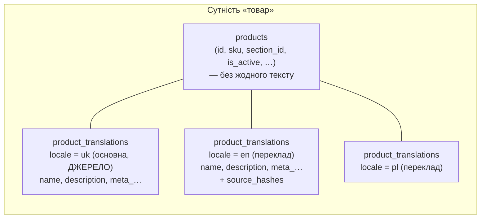
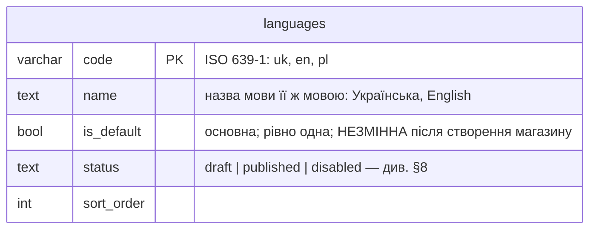
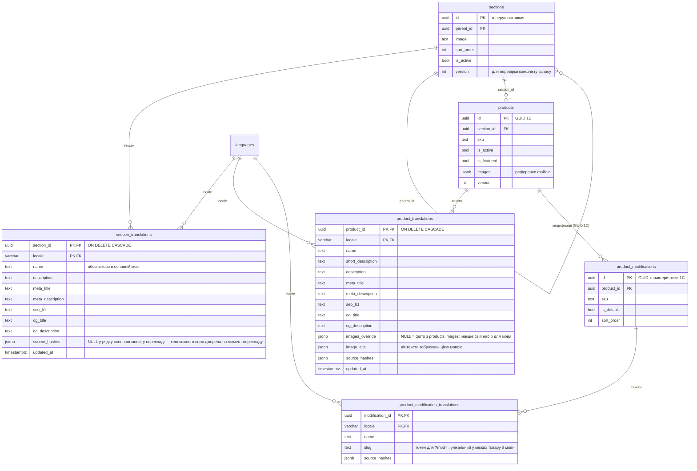
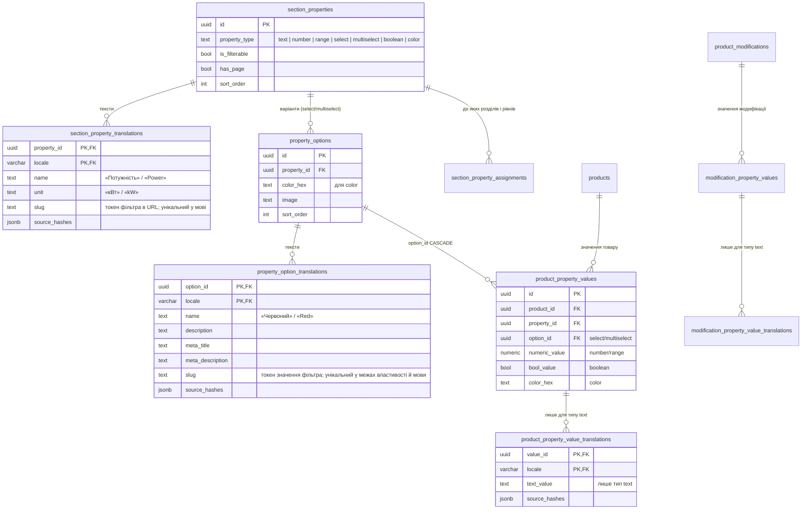
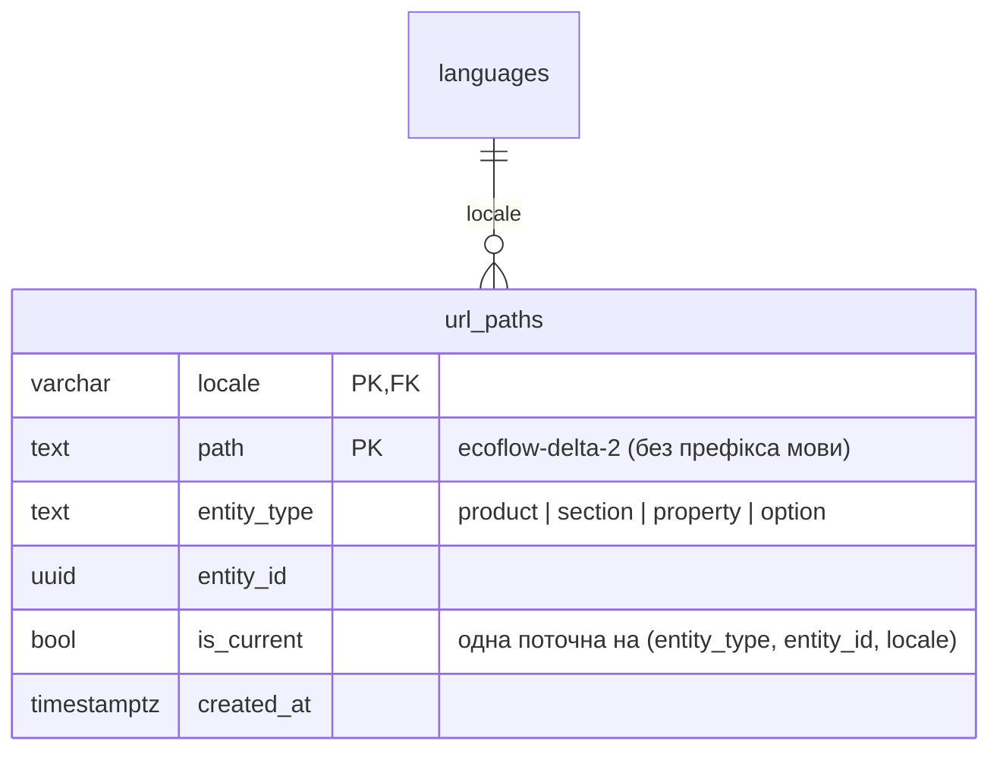
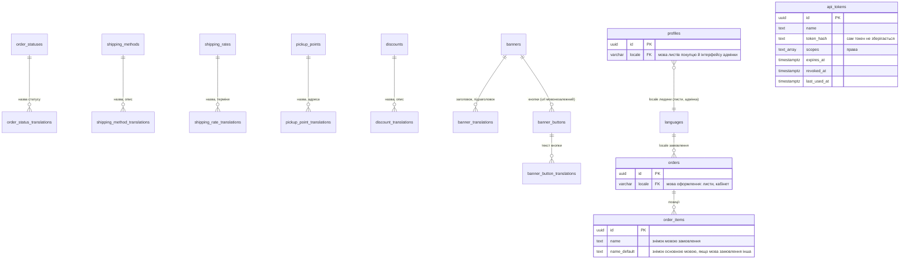
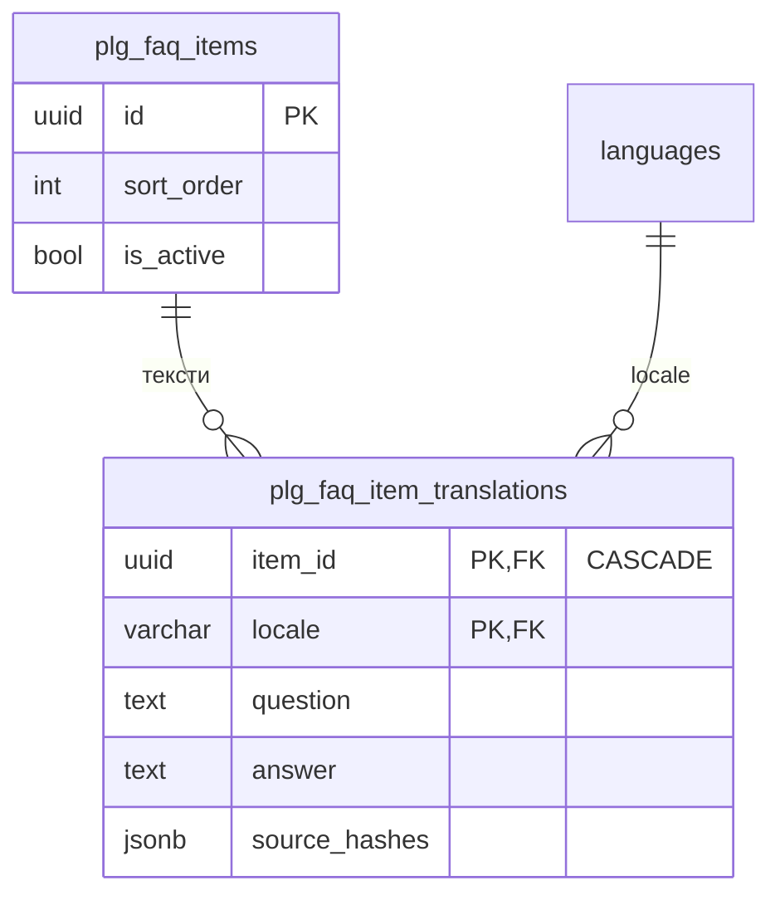
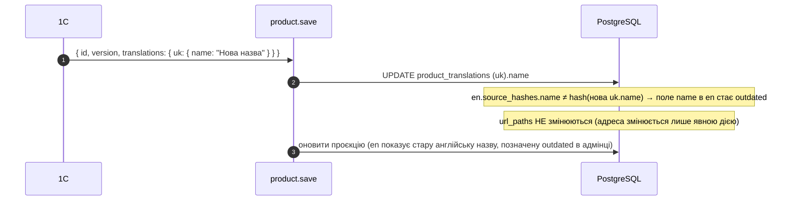

# Мультимовність — модель даних (контракт БД), діаграми

> Статус: СХВАЛЕНО власником 2026-10-15 разом із дизайном хвилі. Доповнює дизайн хвилі
> [`2026-10-14-multilingual-wave-design.md`](2026-10-14-multilingual-wave-design.md) §4–§7 і журнал рішень
> [`2026-10-14-content-multilingual-design.md`](2026-10-14-content-multilingual-design.md).
> Рішення власника 12–19 (2026-10-14) внесено. Імена колонок — робочі. Остаточні фіксує план, але форма (які таблиці, ключі, зв'язки, інваріанти) — це
> контракт.

## 1. Одне правило на всю систему

Кожна сутність, яка має видимий у магазині текст, складається з ДВОХ таблиць:

- **базова таблиця `<entity>`** — лише мовонезалежне: id, зв'язки, коди, числа, прапорці, ціни, зображення;
- **таблиця перекладів `<entity>_translations`** — по одному рядку на (сутність, мова), лише тексти.

Рядок основної мови — це «джерело». Він обов'язковий: без нього сутності немає. Решта мов — переклади.



## 2. Мови



- Основну мову задають при створенні магазину; змінити її не можна, і БД це забороняє.
- Мови не видаляються, лише вимикаються (`disabled`). Їхні переклади лишаються.

## 3. Каталог: товар, модифікація, розділ



## 4. Властивості (модель 1С) і їхні значення

Властивість — довідник. Плагіни властивостей не додають, лише використовують. Значення розщеплено за типом:
перекладається лише текстове значення.



## 5. Адреси сторінок — реєстр

Slug сторінок (товар, розділ, сторінка властивості, сторінка опції) живе ЛИШЕ тут, а не в таблицях сутностей.



- `/ecoflow-delta-2` → (`uk`, `ecoflow-delta-2`) → товар X.
- `/en/ecoflow-delta-2` → (`en`, `ecoflow-delta-2`) → той самий товар X. Однакова адреса в різних мовах
  дозволена.
- Стара адреса: рядок з `is_current = false` → 301 на поточну адресу тієї ж сутності й мови.
- Службові сегменти (`cart`, `checkout`, `my`, `api`, `media`, коди мов) зарезервовані: такої адреси
  створити не можна.

## 6. Довідники, контент, замовлення, доступ



Зображення (рішення власника 17): будь-яке зображення сутності можна перевизначити для мови в її рядку перекладу
(NULL — спільне), alt-тексти перекладаються. Форму (поле в рядку чи окрема таблиця зображень із мовою) обирає план.

Відгуки: `product_reviews.locale` — мова написання; показуються всі, мовою сторінки першими (рішення 18).

Не перекладаються: `price_types`, `category_rules` (лише адмінка), відгуки (мова автора), дані покупців, ціни,
залишки.

## 7. Плагіни — та сама конвенція



Плагін оголошує таблицю засобом SDK (наприклад `defineTranslatableTable`), який створює обидві таблиці
однаково правильно. Контроль — §10 дизайну і розділ «Контроль» у відповіді власнику.

## 8. Як дані створюються й змінюються

### 8.1 Створення товару (адмінка або API — та сама операція)

```mermaid
sequenceDiagram
  autonumber
  participant C as Адмінка / API / 1С
  participant O as Операція реєстру «product.save»
  participant DB as PostgreSQL (одна транзакція)
  C->>O: { id, sku, …, translations: { uk: {name…}, en: {name…}? } }
  O->>O: Zod: є основна мова (uk) з name? права?
  O->>DB: INSERT products (id від викликача)
  O->>DB: UPSERT product_translations (uk) — джерело
  O->>DB: UPSERT product_translations (en) — якщо надіслано; source_hashes = хеші нового джерела
  O->>DB: INSERT url_paths (uk, slugify(name)) — при зайнятості суфікс -2
  O->>DB: INSERT url_paths (en …) — копія основної адреси для кожної активної мови
  O->>DB: оновити проєкцію вітрини для цього товару
  DB-->>DB: COMMIT: відкладені перевірки (рядок основної мови є; адреси унікальні)
  O-->>C: { id, version }
```

### 8.2 Перейменування з 1С (лише основна мова)



### 8.3 Увімкнення нової мови

```mermaid
sequenceDiagram
  autonumber
  participant A as Власник (сторінка мов)
  participant O as language.activate
  participant DB as PostgreSQL
  A->>O: додати pl (статус draft)
  O->>DB: INSERT languages (pl, draft)
  O->>DB: для кожної сутності зі сторінкою: url_paths (pl) = копія основної адреси
  Note over A,DB: draft — вітрина pl ще не відкрита; перекладачі працюють в адмінці
  A->>O: опублікувати pl (видно індикатор повноти)
  O->>DB: UPDATE languages SET status = published
  Note over DB: вітрина /pl/… відкрита; неперекладені сторінки — noindex
```

## 9. Що з чого читає вітрина

```mermaid
flowchart TB
  URL["/en/ecoflow-delta-2"] --> R["розбір: мова = en (з префікса), path = ecoflow-delta-2"]
  R --> UP["url_paths (en, path) → товар X"]
  UP --> PR["проєкція: catalog_product_texts (X, en)<br/>текст з fallback на основну мову + is_translated"]
  PR --> H{"is_translated?"}
  H -- так --> I["index, self-canonical, hreflang"]
  H -- ні --> N["noindex, canonical на основну мову"]
  R --> T["переклади інтерфейсу: каталог i18n для en<br/>(немає пакета en → основна мова магазину)"]
```


